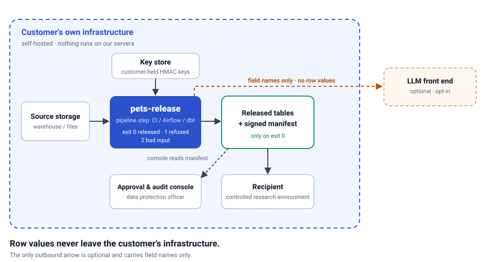

# sinceai: purpose-first PETs

Team project for the **TrustED PETs Transformer** challenge at Since AI Hackathon 2026 (Turku, 6-8 Nov 2026).
**Submission deadline: Sunday 8 Nov, 10:00 EET (fixed), on sinceai.app.**

> Release only what the purpose needs, at the coarsest detail that still serves it, and prove both the privacy and the utility.

`pets-release` is an offline, deterministic command-line tool. Give it a sharing scenario and the source data. It builds a protected release, runs a fail-closed gate over it, and writes a signed privacy manifest. Anyone holding the release can re-run the release-derivable checks. Terms follow [GLOSSARY.md](GLOSSARY.md).

Final HEALTH-S1 proof: **c52424c**, merged to main as **cc66ac2**. The gate ran
**42 checks: 42 pass, 0 not applicable**; release, limited verification and full
verification all exited 0. Kit privacy is 0.1716 → 1.0; mean utility over five
tasks is 1.0 → 0.9188. These are scoped measurements, not anonymity guarantees:
with diagnosis additionally known, 73.6% of persons are below k=5. See the
[final numbers and limitations](docs/story/06-numbers-to-fill.md) and
[recorded proof sources](docs/story/PRE-FILL-SOURCES.md).

## Quick start (Windows, PowerShell)

Requirements: Python 3.10 or newer on `PATH` as `python` (the project uses 3.14), and the challenge kit. The kit is never committed: it lives in `Briefs/` (gitignored) or wherever you unpacked it.

Use the venv executables directly: no activation or execution-policy change is needed,
even under PowerShell's default `Restricted` policy.

<!-- docs-test: skip reason=environment-setup -->
```powershell
python -m venv .venv
.\.venv\Scripts\python.exe -c "import sys; print(sys.executable)"
.\.venv\Scripts\python.exe -m pip install -e ".[dev,eval]"
.\.venv\Scripts\python.exe -m pip install -e "Briefs\TRUSTED_PETS_PROVING_GROUND_2026 (1)\TRUSTED_PETS_PROVING_GROUND_2026\toolkit"
```

The interpreter check must print this clone's `.venv\Scripts\python.exe`, not a system Python.

Settings come from the environment. Nothing is read from a file, and nothing is written back.

| Variable | Used for | Rule |
|---|---|---|
| `PETS_KIT` | Path to the kit root (the folder holding `data/`, `metadata/`, `docs/`) | Or pass `--kit` |
| `PETS_HMAC_KEY` | Master key for pseudonyms and the manifest signature | At least 32 characters, else exit 2. Never commit it, never paste it into a log |
| `SOURCE_DATE_EPOCH` | Creation time as Unix seconds | Or pass `--created`. If neither is set, exit 2 |

<!-- docs-test: skip reason=sets-secret-placeholder-only -->
```powershell
$env:PYTHONUTF8 = "1"
$env:TZ = "UTC"
$env:PYTHONPYCACHEPREFIX = "$env:LOCALAPPDATA\sinceai-pycache"
$env:PETS_KIT = "<path to the kit root>"
$env:PETS_HMAC_KEY = "<at least 32 characters, from your own secret store>"
$env:SOURCE_DATE_EPOCH = "1793000000"
```

Check that the install works and that the kit is readable (these print table names, row counts and input digests, no values):

<!-- docs-test: run -->
```powershell
.\.venv\Scripts\pets-release.exe --help
.\.venv\Scripts\pets-release.exe kit-info --dataset health --kit "$env:PETS_KIT"
```

The later examples also use the venv executables directly; activation is not required.

Exit codes: `0` success; `1` refusal or verify failure; `2` usage error or unknown state. Unknown counts as failure.

## Run it in your pipeline

The engine (library + CLI) is the product: a **self-hosted pipeline step** for CI,
Airflow or dbt inside your own infrastructure, where row values stay local.
The web app is **the approval and audit console** for one run; a self-hosted REST
API is future work.



This GitHub Actions job assumes a trusted, self-hosted Linux runner with Bash,
the project and kit toolkit installed in its `python` environment, and `PETS_KIT`
set to the local kit root. Supply `PETS_HMAC_KEY` from your own secret store
(here, a GitHub Actions secret), never a command-line argument. Use a fresh output
path outside the checkout on every attempt. Configure `PYTHONUTF8=1` and `TZ=UTC`
on the runner. Do not run untrusted pull-request code with this key or kit.

<!-- docs-test: skip reason=pipeline-needs-real-kit-and-secret-store -->
```yaml
jobs:
  release:
    runs-on: [self-hosted, linux]
    env:
      PETS_HMAC_KEY: ${{ secrets.PETS_HMAC_KEY }}
      PETS_RELEASE_OUT: ../sinceai-out/pipeline-${{ github.run_id }}-${{ github.run_attempt }}
    steps:
      - uses: actions/checkout@v4
      - shell: bash
        run: |
          python -m pets_release run --scenario HEALTH-S1 --out "$PETS_RELEASE_OUT" --created 2026-11-07T08:00:00Z --kit "$PETS_KIT"
          python -m pets_release verify --full --kit "$PETS_KIT" "$PETS_RELEASE_OUT"
      - uses: actions/upload-artifact@v4
        with:
          name: signed-privacy-manifest
          path: ${{ env.PETS_RELEASE_OUT }}/privacy_manifest.json
          if-no-files-found: error
```

The example is **verified locally with the same commands** on the real kit;
exit codes, elapsed times and revision-bound artefacts are recorded in issue
[#145](https://github.com/Suhtetark-Kool/sinceai/issues/145). The named skip keeps this
long, secret-dependent run out of the synthetic README command tests.

The `run` exit-code contract is **0 = released**, **1 = refused or a check failed**,
**2 = bad input/configuration or unknown state**. Only 0 permits the next step;
unknown is failure, never permission to publish. Actions' explicit `shell: bash`
uses `-e -o pipefail`, so a nonzero `run` or `verify` stops this job before upload.
Full verification re-runs producer and release checks and validates the signature
using the kit and environment key. A recipient without them can run limited
verification, which does not authenticate the signature. Only the content-free
signed manifest is uploaded here, not protected tables, private scoring artefacts,
row maps or keys. Deliver protected tables separately to the intended recipient
inside your approved sharing boundary.

## Demo

The supported release demo is HEALTH-S1 (ED visits to a university research group),
with live detection on the `unseen` export. CS-S1 releases are not supported in
this version (D46); they are future work, not a runnable release demo.

### Local web app

Set `PETS_KIT` and `PETS_HMAC_KEY` in the server's environment as above. The key is never
entered in, returned to, or logged by the browser. Choose a **new** output directory for
each server launch; existing directories are refused rather than reused.

<!-- docs-test: skip reason=starts-a-long-running-server -->
```powershell
.\.venv\Scripts\python.exe -m pets_release.ui --kit "$env:PETS_KIT" --out ..\sinceai-out\ui-demo --created 2026-11-07T08:00:00Z
```

Open the token-bearing URL printed at startup. The server binds only `127.0.0.1`
(`--port 8765` by default; `--port 0` chooses a free port). Every request needs that
launch's random token. Stop with Ctrl+C. Treat the URL as a capability: share it only
with intended demo viewers. The hosted demo uses the same loopback listener behind
a forwarder; the app makes no assumptions about the host.

Choose HEALTH-S1 to run the unchanged production CLI, see gate counts, both verification
tiers, purpose scores, sacrifices and residual risks, then open the manifest-only dashboard.
Five separate demonstration views cover data types and risks, PETs and why, protected
output, measured privacy and utility, and scenario and limitations. The targets table
keeps strict utility thresholds separate from allowed sacrifice floors. Missing scores
are **not measured**, never assumed met.

The protected-rows view shows the first 10 released rows per table (`--preview-rows N`,
1–25). Every display re-runs limited verification on the release and an exact-byte
snapshot, and checks manifest-listed file digests. No raw input, row maps, `truth/`,
unlisted files or paths outside the release are served. Before/after comparisons are
field-level only. Agents must not read or screenshot real-kit row pages. The production
identifier scanner still guards responses; only verified row responses permit the
64-hex keyed-pseudonym shape, whose column placement the production release checks enforce.

Set `PETS_UI_DEMO_BANNER` or pass `--demo-banner "Demo — synthetic kit data"` for an
optional banner. Only one run can be active; another start returns HTTP 409 with
"Busy, run in progress". Refusals show available check names and counts, or explicitly
say that no refusal report is available.

The UI has no external assets, raw previews, table downloads, or row-map routes. The offline
guard blocks new sockets in the server and its CLI children; only the pre-bound loopback
listener accepts incoming connections. Release bytes match the CLI for the same inputs,
key, creation time, plan and tool revision.

CS-S1's policy is selectable, but this integration revision's production `run` pipeline
supports only HEALTH-S1. A CS-S1 attempt is shown as **FAILED**, never as a release.
The UI cannot bypass the production pipeline's refusal or an unavailable check.

### 1. Live detection on `unseen`

<!-- docs-test: run -->
```powershell
.\.venv\Scripts\pets-release.exe detect unseen --out ..\sinceai-out\unseen_field_labels.csv --format unseen --kit "$env:PETS_KIT"
```

### 2. HEALTH-S1 release

`--created` pins the creation time. The same input, key, creation time and tool versions give a byte-identical release.

#### Measured search (default)

Omit `--plan` to run the deterministic, bounded search: it measures purpose checks,
tries withholding and coarsening, then re-checks purpose checks and privacy targets
after local suppression. No acceptable candidate means refusal, not a fallback to
the hand plan. Field justifications and `measured.search` describe the search;
the candidate log stays outside the release in `<out>.scoring/search_log.jsonl`.

`--recipient` binds the recipient ID into the release scope and derives a separate
pseudonym key. Joins survive within a release, but tokens do not link across
recipients. Use a stable, non-sensitive ID matching `[A-Za-z0-9][A-Za-z0-9._-]{0,63}`;
`default` and `manifest-signature` are reserved. Omission keeps the legacy default
recipient; it does not select a recipient-specific derived key.

<!-- docs-test: run -->
```powershell
.\.venv\Scripts\pets-release.exe run --scenario HEALTH-S1 --recipient research-group --out ..\sinceai-out\health-s1 --created 2026-11-07T08:00:00Z --kit "$env:PETS_KIT"
```

The walking-skeleton hand plan remains available explicitly. It bypasses the
search, not the gate, suppression or final purpose checks. Use a fresh output
folder for each run:

<!-- docs-test: run -->
```powershell
.\.venv\Scripts\pets-release.exe run --scenario HEALTH-S1 --plan hand --recipient research-group --out ..\sinceai-out\health-s1-hand --created 2026-11-07T08:00:00Z --kit "$env:PETS_KIT"
```

#### Full before/after measurement

The default search measures candidate purpose checks; it does not by itself fill
the scorecard's before/after utility, privacy and published baseline comparison.
Use the measured wrapper for those. Its CLI accepts the same arguments as `run`:
no `--plan` means search, `--plan hand` selects the hand plan, and `--recipient`
is passed to both builds.

<!-- docs-test: run -->
```powershell
.\.venv\Scripts\python.exe -m pets_release.measure.wire --help
```

The full command needs the real kit, its published `results/benchmark.json`, and
the installed `pets-eval` toolkit. The synthetic README ledger therefore names
that dependency as a skip; real-kit evidence must run it separately, not count
the skip as success:

<!-- docs-test: skip reason=measure-wire-needs-full-kit-scorecards -->
```powershell
.\.venv\Scripts\python.exe -m pets_release.measure.wire --scenario HEALTH-S1 --recipient research-group --out ..\sinceai-out\health-s1-measured --created 2026-11-07T08:00:00Z --kit "$env:PETS_KIT"
```

This builds a scratch release, scores before/after through the kit-eval adapter,
then gates and signs a second build with the measured narrative. The protected
tables must match the scratch build byte-for-byte. Raw scorecards and scratch
tables remain local under `<out>.measure/`; row maps stay outside the release.
Use fresh paths: an existing release or measure scratch folder is an error.
The measured release supports the same `verify` and `verify --full` commands below.

#### CS-S1: unsupported in this version (D46)

CS-S1 is dropped from this submission's release scope and deferred to future
work (D46). The strict gate refuses the CS-S1 release rather than weakening
privacy checks to publish it; builds without CS-S1 integration reject the scenario
earlier as unsupported. This is an honest limitation, not a successful release.
The measured wrapper does not bypass it. The command below is deliberately
skipped, not an instruction to run a supported release. CS evaluation exports
still ship through the submission packager under D37; they are not a gated CS-S1
release.

<!-- docs-test: skip reason=cs-s1-deferred-d46 -->
```powershell
.\.venv\Scripts\pets-release.exe run --scenario CS-S1 --out ..\sinceai-out\cs-s1 --created 2026-11-07T08:00:00Z --kit "$env:PETS_KIT"
```

A release folder holds one `<table>.csv` per released table and `privacy_manifest.json`, nothing else. The gate refuses any other file. If a check finds a high-severity violation, errors or does not run, the tool exits 1, prints counts by check and label (never values), and publishes nothing.

### 3. Verify, in two tiers

Recipient mode needs only the release folder. It re-runs every release-scope check, recomputes file digests and validates the manifest against the schema. Its success line always says **limited**:

```text
VERIFIED (limited): N release-checked, M producer-attested
```

<!-- docs-test: run -->
```powershell
.\.venv\Scripts\pets-release.exe verify ..\sinceai-out\health-s1
```

Controller or auditor mode (`--full`) also needs the kit and the key. It re-runs every check in the registry, including the producer-scope ones (original-value survival, reversible hashes, key material, per-person k), the input digests, the tool revision and the signature. Any check that cannot run is a failure.

<!-- docs-test: run -->
```powershell
.\.venv\Scripts\pets-release.exe verify --full --kit "$env:PETS_KIT" ..\sinceai-out\health-s1
```

| | `verify <release>` (limited) | `verify --full --kit <path>` |
|---|---|---|
| Who | Recipient, anyone holding the folder | Controller or auditor with the key |
| Needs | Release folder | Release folder, kit, `PETS_HMAC_KEY` |
| Checks | Release-scope only | Release and producer scope, signature, input digests, tool revision |
| Success line | `VERIFIED (limited): N release-checked, M producer-attested` | Full verification |
| Unavailable check | Counted as producer-attested | Failure |

Limitation: digests catch accidents only. Someone who edits a release can recompute them. Only `--full` checks the signature, and only the key holder can run it.

### 4. Dashboard

A static HTML file rendered from the manifest alone. No network assets and no row values.

<!-- docs-test: run -->
```powershell
.\.venv\Scripts\pets-release.exe dashboard ..\sinceai-out\health-s1 --out ..\sinceai-out\health-s1-dashboard.html
```

### Optional LLM draft policy

`pets-release draft-policy` produces a validated draft policy for human review,
not a release. Feeding the draft into the search is future work (D51); `run`
still uses packaged scenario policies. The optional sender requires explicit
`--allow-network` and sees only screened request text and allowlisted field
metadata, never row values. D47 permits the Mistral API; other OpenAI-compatible
endpoints remain configurable. Keys stay in the sender's environment.
See [docs/llm-front-end.md](docs/llm-front-end.md) for configuration and validation.
This help command makes no network request:

<!-- docs-test: run -->
```powershell
.\.venv\Scripts\pets-release.exe draft-policy --help
```

### Evidence pack for a DPO / Findata

Export content-free HTML and Markdown from the signed manifest only. Set the
signing release's `PETS_HMAC_KEY`; invalid manifests or signatures refuse the export.
The seven sections cover purpose, legal basis/DPIA, methods, measured risk, utility,
verbatim residual risks and reproducibility. Missing measurements stay **not measured**;
legal basis and DPIA are **To be supplied by the data controller**. This is technical
evidence, not a permit or a DPIA. It never reads tables and does not replace `verify`.
The exporter is shipped (#147); an existing real-kit pack is linked in the
[source ledger](docs/story/PRE-FILL-SOURCES.md). That earlier feature artefact is
not a new export from the c52424c proof run.
The example needs the signed measured release built above; its ledger skip is not a pass.

<!-- docs-test: skip reason=evidence-pack-needs-signed-measured-release-and-controller-key -->
```powershell
.\.venv\Scripts\pets-release.exe evidence-pack ..\sinceai-out\health-s1-measured --out ..\sinceai-out\health-s1-evidence.html
```

### 5. Submission bundle

The bundle goes to `..\sinceai-out\pets_submission`, outside every repo. A complete bundle is the default. Under D46 it holds a verified HEALTH-S1 release (tables, validated row maps, manifest), the unseen labels and the gated CS eval redactions and spans (D37). CS-S1 is out of scope (deferred, D46). `submission_index.json` records that in `outOfScope`, and the packager neither needs nor accepts a CS-S1 release.

The default search retains the record keys needed to recompute and validate row maps (#128). Package the default search release below; if you already ran step 2, skip the first command rather than reuse its output path:

<!-- docs-test: run -->
```powershell
.\.venv\Scripts\pets-release.exe run --scenario HEALTH-S1 --recipient research-group --out ..\sinceai-out\health-s1 --created 2026-11-07T08:00:00Z --kit "$env:PETS_KIT"
.\.venv\Scripts\pets-release.exe submission --out ..\sinceai-out\pets_submission --release ..\sinceai-out\health-s1 --kit "$env:PETS_KIT"
```

It prints `SUBMISSION BUILT (COMPLETE)`. Without a HEALTH-S1 release (`REFUSED: incomplete`), or without the kit's unseen or CS eval exports, it refuses and writes nothing. With HEALTH-S1 as the only target (D46), a valid release still prints `SUBMISSION BUILT (COMPLETE)` when `--partial` is passed; `--partial` with no release exits 1 (`REFUSED: no_release`). There is no supported CLI input that builds a `PARTIAL` bundle in this cut.

The human submission wizard on `main` uses a separate, older two-folder layout check. Stage 5 reports `Partial bundle; missing required items:` followed by `customer_service/` for this D46-complete bundle and requires the typed acknowledgement `PARTIAL` (D59) before pushing. That is the wizard's layout warning, not the packager's `SUBMISSION BUILT` status or a CS-S1 release requirement. Keep the acknowledgement; do not fabricate a `customer_service/` release to silence it. The bundle index records `targetDatasets: ["health"]`, `datasetsMissing: []` and CS-S1 in `outOfScope`.

## Where row maps go

Row maps (`rowmap_<table>.csv`) are scoring aids, not part of a release. They are written to `<out>.scoring/`, next to the release folder, never inside it. The same folder holds raw scorecard output, the search log and refusal reports.

They must never enter the public repo (decision D15, [ADR 0003](docs/adr/)). The organisers receive them only through the private repo `Suhtetark-Kool/trusted-since-ai`. `pets_submission/` is built outside this repo for that purpose. `.gitignore` already excludes `Briefs/`, `rowmap_*.csv`, `truth/`, `pets_submission/` and `.env`; do not force-add them.

Human-run submission wizards (Git Bash on Windows): [Saturday private handoff](scripts/wizard/saturday-submission.sh) and [Sunday public submission](scripts/wizard/sunday-submission.sh). From the repo root in PowerShell, run `& 'C:\Program Files\Git\bin\bash.exe' scripts/wizard/saturday-submission.sh` (or `sunday-submission.sh`). They prompt before consequential actions and save public setup values in the ignored root `.env`; the tool itself does not read that file.

## Reproducibility

- Same input, key, `--created` (or `SOURCE_DATE_EPOCH`) and tool versions give a byte-identical release. Rows and lists are sorted; the only time value is the creation time.
- Run Python with `PYTHONUTF8=1` and `TZ=UTC`; keep bytecode outside the tree with `PYTHONPYCACHEPREFIX=%LOCALAPPDATA%\sinceai-pycache` (D30). Do not disable bytecode on the top-level test command.
- The tool blocks network sockets at start-up, and subprocesses inherit the block.
- Every CSV is read with `dtype=str`. Never let pandas infer types.
- Implementers run only affected tests: `powershell -NoProfile -ExecutionPolicy Bypass -File scripts/overnight/affected-tests.ps1 -Worktree <your worktree> -Run` (D27; process-only policy override, no persistent setting change). Full-suite integration check, for the merger only:

<!-- docs-test: skip reason=runs-the-whole-test-suite-recursively -->
```powershell
$env:PYTHONUTF8 = "1"; $env:TZ = "UTC"; $env:PYTHONPYCACHEPREFIX = "$env:LOCALAPPDATA\sinceai-pycache"
.\.venv\Scripts\python.exe -m pytest -n auto --import-mode=importlib tests
```

Tests marked `kit` need `PETS_KIT` and are reported as not run when it is absent.

## Documentation

| Doc | What's in it |
|---|---|
| [docs/setup.md](docs/setup.md) | Local environment, `pets-eval` toolkit, repo hygiene |
| [docs/challenge.md](docs/challenge.md) | The challenge, the data package, deadlines, how judging works |
| [docs/concept.md](docs/concept.md) | Our angle: purpose-first data minimisation, and why it differentiates |
| [docs/tool-spec.md](docs/tool-spec.md) | The tool: pipeline, components, inputs and outputs |
| [docs/evaluation-strategy.md](docs/evaluation-strategy.md) | How we measure ourselves without overfitting |
| [docs/build-plan.md](docs/build-plan.md) | Sequencing, checkpoints, workstreams, risks |
| [docs/decisions.md](docs/decisions.md) | What's decided and what's still open |
| [HACKATHON_PLAN.md](HACKATHON_PLAN.md) | Engine and proof: scenario compiler, free-text redactor, timeline |
| [PRIVACY_PATTERNS_PLAN.md](PRIVACY_PATTERNS_PLAN.md) | Keyed pseudonyms, fail-closed gate, privacy manifest, offline |
| [docs/adr/](docs/adr/) | Architecture decision records |
| [docs/decision-log.md](docs/decision-log.md) | Append-only execution log kept by the orchestrator |
| [AGENTS.md](AGENTS.md) | Steering file for agents: hard rules, tracker, domain docs |
| [GLOSSARY.md](GLOSSARY.md) | Shared vocabulary |

## Repo layout

```
Briefs/                 challenge briefs + data package (NOT committed)
docs/                   planning, specs, decisions
src/pets_release/       the tool (CLI: pets-release)
src/pets_attacker/      validation-only attacker (the only code allowed to read truth/)
tests/                  pytest suites; tests/docs checks this README
GLOSSARY.md             project vocabulary
```
